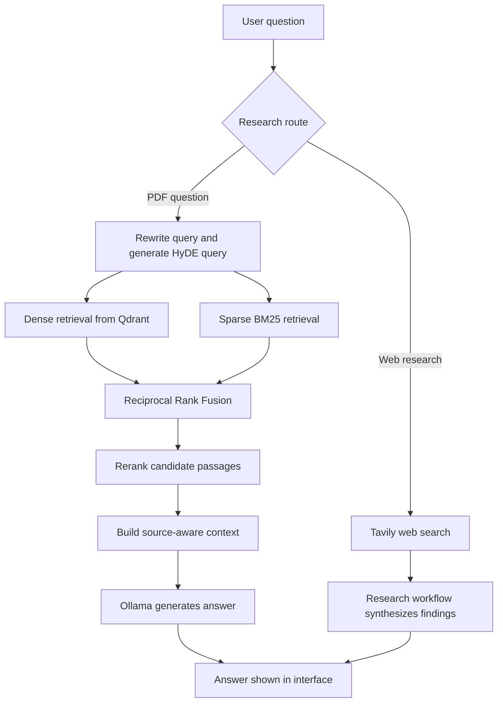

# AI Agentic Research Assistant

An AI-powered research assistant that combines web research and Retrieval-Augmented Generation (RAG) to help users ask questions, explore information, and get answers grounded in source documents.

The project is built as a learning and portfolio project focused on practical AI Engineering concepts, including agent workflows, hybrid retrieval, reranking, local LLM inference, and automated testing.

## Features

- **PDF question answering:** retrieve relevant passages from ingested PDF documents and use them as context for answer generation.
- **Hybrid retrieval:** combine dense vector search with sparse BM25 retrieval to find relevant document passages.
- **Query enhancement:** use query rewriting and Hypothetical Document Embeddings (HyDE) to improve retrieval for supported RAG queries.
- **Reciprocal Rank Fusion (RRF):** combine ranked results from different retrieval methods.
- **Reranking:** reorder candidate passages before sending the most relevant context to the language model.
- **Web research:** use Tavily for web search in the research workflow.
- **Local LLM inference:** use Ollama to run the configured language model locally.
- **Vector storage:** use Qdrant to store and search document embeddings.
- **Source-aware answers:** format retrieved context with source filenames and page numbers to support citations.
- **Logging and exception handling:** capture useful application events and surface failures for debugging.
- **Automated tests:** include unit tests for RAG orchestration and citation formatting, plus retrieval smoke tests.

## Technology Stack

| Area | Technologies |
|---|---|
| Language | Python |
| Agent workflow | LangGraph, LangChain |
| Local language model | Ollama (`gpt-oss:20b`) |
| Embeddings | Ollama (`nomic-embed-text`) |
| Vector database | Qdrant |
| Sparse retrieval | FastEmbed BM25 (`Qdrant/bm25`) |
| Web search | Tavily |
| PDF ingestion | PyPDFLoader / LangChain Community |
| Frontend | HTML, CSS, JavaScript |
| Containerization | Docker, Docker Compose |
| Testing | pytest |

> Model names and package APIs can change over time. Use the model names and dependency versions configured in this repository.

## How It Works



The exact route and execution path depend on the query and the current graph configuration. The diagram describes the main intended workflows rather than every internal branch.

## Project Structure

The repository may contain additional files as the project evolves. The key modules include:

```text
.
├── app.py
├── main.py
├── index.html
├── requirements.txt
├── docker-compose.yml
├── data/
├── src/
│   ├── retrival.py
│   ├── rag_node.py
│   ├── generate_answer.py
│   ├── chunking.py
│   ├── embeddings.py
│   ├── logger.py
│   └── exception.py
└── tests/
    ├── test_rag_node.py
    ├── test_citations.py
    └── test_retrieval_quality.py
```

This is an indicative structure based on the project modules. If a listed file is absent in your current branch, use the actual file structure in the repository.

## Prerequisites

Install or prepare the following before running the application:

- Python version compatible with the repository's dependencies
- Git
- Docker Desktop
- Ollama
- A Tavily API key for web research
- Sufficient memory and disk space for the configured local LLM

The `gpt-oss:20b` model is relatively large. Local inference speed and memory requirements depend on your hardware.

## Setup

### 1. Clone the repository

```bash
git clone <YOUR_GITHUB_REPOSITORY_URL>
cd <YOUR_REPOSITORY_DIRECTORY>
```

Replace the placeholders with your GitHub repository URL and directory name.

### 2. Create and activate a virtual environment

Windows PowerShell:

```powershell
python -m venv .venv
.\.venv\Scripts\Activate.ps1
```

If PowerShell blocks activation, you can run the environment's Python executable directly:

```powershell
.\.venv\Scripts\python.exe -m pip install -r requirements.txt
```

Install the dependencies:

```powershell
python -m pip install -r requirements.txt
```

If your repository uses `uv` and has a `pyproject.toml`, follow the `uv` workflow defined in that file instead.

### 3. Start Ollama and download the models

Ensure Ollama is installed and running, then pull the configured models:

```bash
ollama pull gpt-oss:20b
ollama pull nomic-embed-text
```

Check that the models are available:

```bash
ollama list
```

The application must be configured to use the same model names. Keep Ollama's API local unless you have deliberately configured and secured a remote deployment.

### 4. Start Qdrant

Start the Qdrant service using the repository's Docker Compose configuration:

```bash
docker compose up -d qdrant
```

Check the running containers:

```bash
docker compose ps
```

The project has been configured to use Qdrant at `http://localhost:6333`. Do not expose Qdrant's port publicly for a classroom demo or portfolio deployment.

If port `6333` is already in use, inspect existing containers before starting another Qdrant instance:

```bash
docker ps
```

### 5. Configure environment variables

Create a `.env` file if the application expects one. Add the environment variables required by your implementation, such as the Tavily API key.

Example:

```dotenv
TAVILY_API_KEY=your_tavily_api_key
```

Use the exact variable names referenced by the code. Do not commit `.env`, API keys, passwords, or other secrets to GitHub. Add `.env` to `.gitignore`.

### 6. Ingest documents

Place the PDF documents you are permitted to use in the project's data directory, then run the ingestion command implemented in the repository.

The ingestion workflow should load PDFs, split their text into chunks, create embeddings, and store the chunks in the configured Qdrant collection. The current retrieval module expects the collection `ai_agent_research` to exist before retrieval begins.

> Run the ingestion workflow before testing PDF question answering. The exact command depends on the repository's ingestion entry point.

### 7. Run the application

Start the backend using the entry point configured in your repository. For example, **if** `app.py` defines a FastAPI instance named `app`, use:

```bash
uvicorn app:app --reload
```

Otherwise, use the actual command for the project's entry point. Open the frontend using the method configured by the application; opening `index.html` directly may not work if the page needs API routes, file uploads, or same-origin requests.

## Running Tests

From the repository root, with the project virtual environment activated:

```bash
python -m pytest -v tests/
```

The current test suite includes:

- RAG node validation and orchestration tests using mocked dependencies
- Citation context-formatting tests
- Retrieval smoke tests that depend on the local Qdrant collection and embedding/retrieval services being available

The retrieval smoke tests are integration-style checks, not a comprehensive benchmark of retrieval quality. Run them only after starting the required services and ingesting the test document(s).

## Example Use Cases

- Ask questions about an ingested research paper.
- Retrieve passages relevant to a question from PDF documents.
- Explore a topic using the web research workflow.
- Compare retrieved source passages with the generated answer.
- Test how query rewriting, hybrid retrieval, fusion, and reranking affect the RAG pipeline.

## Current Status

Implemented and tested components include core RAG orchestration, source-aware context formatting, logging and exception handling, and automated tests for selected behaviours.

The project is still a local-first portfolio prototype. A public demo, if configured, depends on the availability of the host machine and its local Ollama and Qdrant services unless the architecture is changed.

## Limitations and Future Improvements

- Build a repeatable evaluation dataset and measure retrieval quality with metrics such as Recall@k, MRR, or nDCG.
- Evaluate answer faithfulness and citation correctness against manually verified examples.
- Add clearer handling for unsupported questions and missing evidence.
- Add API input validation, request limits, and authentication before exposing the application publicly.
- Improve frontend/backend integration and deployment configuration.
- Add reproducible setup instructions and a small sample document that can be redistributed legally.
- Add monitoring for latency, model errors, and retrieval failures.

## Security Notes

- Never commit API keys or `.env` files.
- Do not expose Ollama or Qdrant ports directly to the public internet.
- A public tunnel exposes the application endpoint to anyone who has the URL unless access controls are added. Use authentication or another access restriction before sharing sensitive data.
- Do not ingest confidential or copyrighted documents unless you have permission to process and share them.

## Acknowledgements

This project was developed as a hands-on AI Engineering learning project to practise agent workflows, retrieval-augmented generation, local model serving, vector databases, and testing.

## Author

**Yuvraj Madhan**

- GitHub: <YOUR_GITHUB_PROFILE_URL>
- LinkedIn: <YOUR_LINKEDIN_PROFILE_URL>

Replace the profile placeholders with your actual links before publishing.
